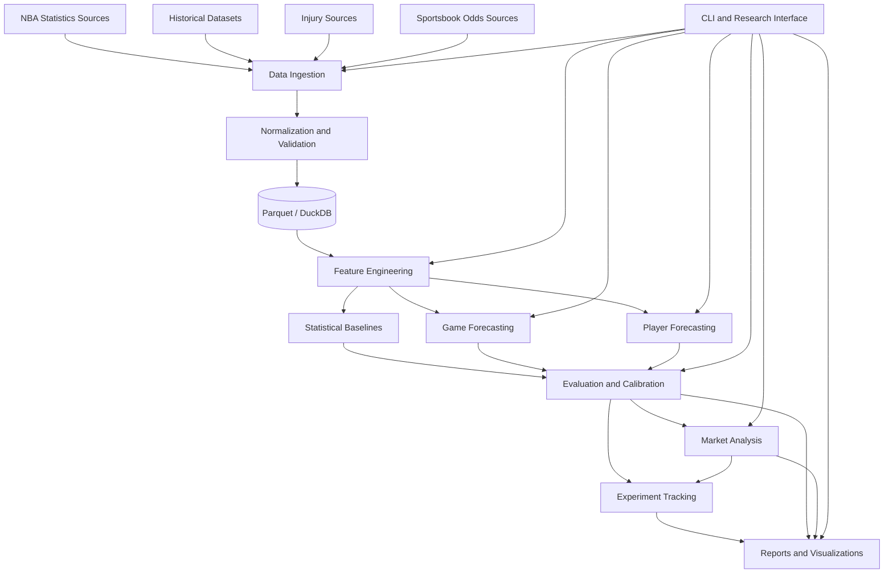
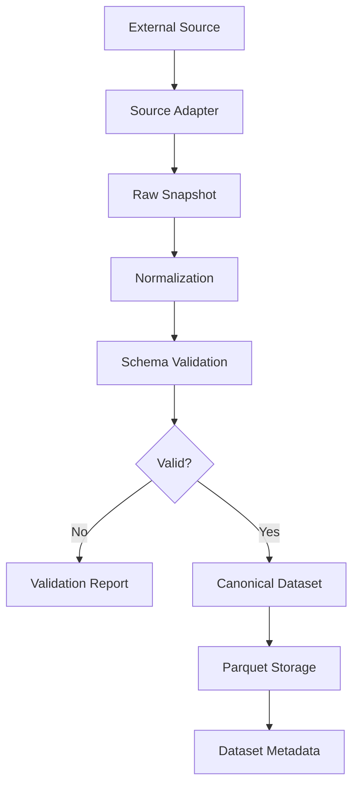
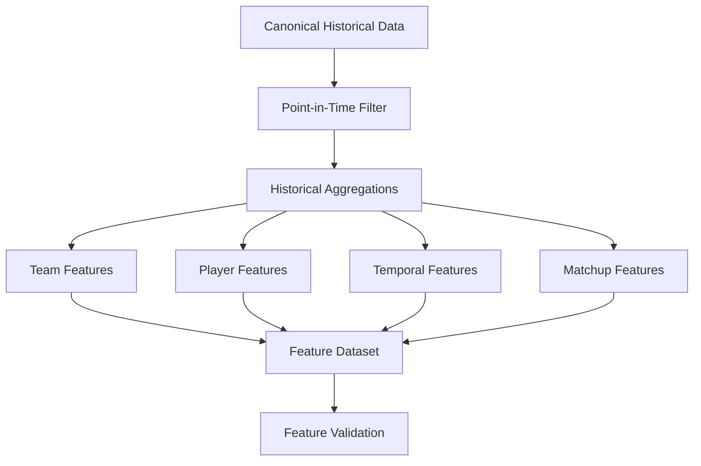
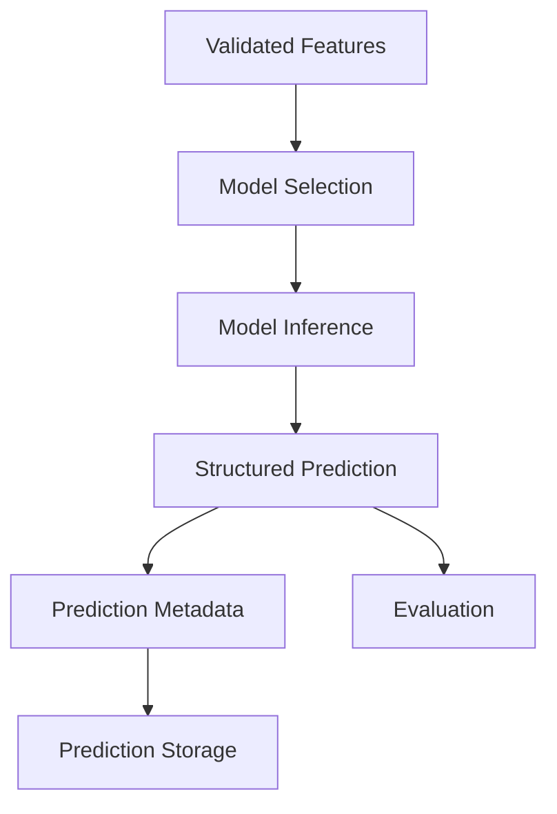
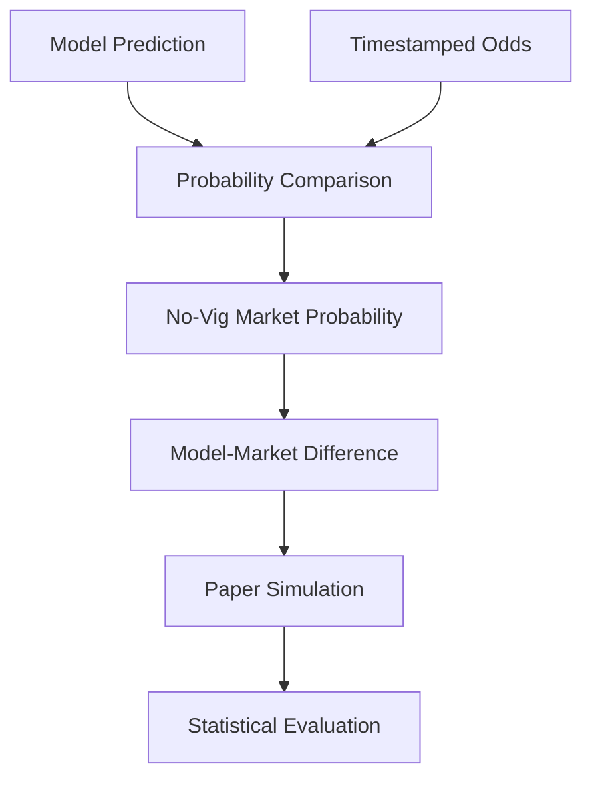
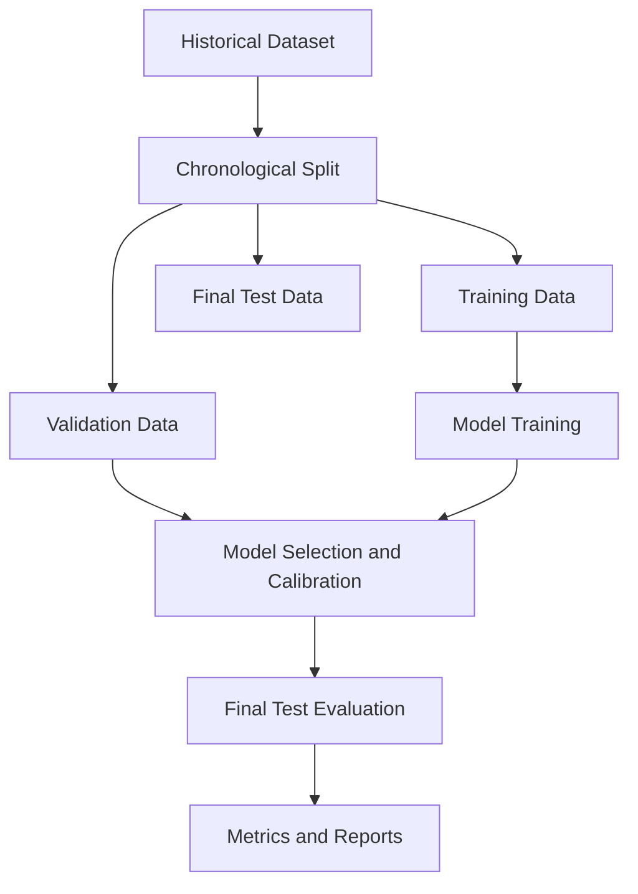

# NBA-DEGENERATE-GAMBLER Architecture

**Version:** 0.1.0  
**Status:** Proposed  
**Architecture Style:** Modular Monolith  
**Language:** Python 3.12+  
**ML Framework:** PyTorch  
**Deployment Model:** Local-first

---

## 1. Architectural Overview

NBA-DEGENERATE-GAMBLER is a local-first machine learning research platform for NBA game forecasting, player performance forecasting, and sportsbook market analysis.

The application uses a modular monolithic architecture with clearly separated domain responsibilities.

The initial architecture prioritizes:

- Reproducible research.
- Point-in-time data correctness.
- Replaceable data sources.
- Independent model evaluation.
- Efficient local execution.
- Minimal infrastructure.
- Clear module boundaries.

The system must remain usable on a machine with limited memory and GPU resources.

### 1.1 Architectural Principles

1. **Data before models:** Reliable datasets are a prerequisite for meaningful forecasting.
2. **Baseline before complexity:** Statistical models establish the minimum performance standard.
3. **Temporal correctness:** Every historical prediction must use only information available at its prediction timestamp.
4. **Reproducibility:** Experiments must be traceable to source code, data, configuration, and random seeds.
5. **Separation of concerns:** Ingestion, features, models, evaluation, and market analysis have distinct responsibilities.
6. **Local-first:** No mandatory cloud services or external infrastructure.
7. **Replaceable integrations:** External data providers must not dictate internal domain schemas.
8. **Evidence-driven complexity:** New abstractions and architectures require a demonstrated need.

---

## 2. System Context

NBA-DEGENERATE-GAMBLER receives external basketball and market data, transforms it into validated historical datasets, builds point-in-time features, trains forecasting models, evaluates their performance, and produces predictions and research reports.



The diagram represents logical dependencies, not separate deployed services.

---

## 3. High-Level Components

### 3.1 Ingestion Layer

**Package:** `nba_oracle.ingestion`

Responsible for retrieving data from external sources.

Responsibilities:

- Source adapters.
- HTTP communication.
- Rate limiting.
- Retries and timeouts.
- Incremental downloads.
- Raw response preservation.
- Retrieval metadata.
- Source-specific error handling.

Candidate sources:

- NBA Stats through `nba_api`.
- Historical public datasets.
- ESPN supplementary endpoints.
- Official NBA injury reports.
- Sportsbook odds providers.

The ingestion layer must not expose source-specific response structures to downstream application modules.

Each adapter translates external data into an internal ingestion representation.

External providers are replaceable. Internal schemas must not depend on one provider's API format.

### 3.2 Data Layer

**Package:** `nba_oracle.data`

Responsible for canonical schemas, normalization, validation, and persistence.

Responsibilities:

- Canonical entity definitions.
- Data normalization.
- Referential integrity.
- Missing-value validation.
- Duplicate detection.
- Historical identity resolution.
- Storage operations.
- Dataset metadata.
- Data version identification.

Initial storage:

- Parquet for persistent analytical datasets.
- DuckDB for analytical queries.
- Local filesystem for raw snapshots and artifacts.

The data layer must not contain model-specific business logic.

### 3.3 Feature Engineering Layer

**Package:** `nba_oracle.features`

Responsible for transforming validated historical data into model-ready features.

Subdomains:

- `team`: team-level performance features.
- `player`: player-level performance features.
- `temporal`: rolling and time-dependent features.
- `matchup`: opponent and matchup features.
- `pipelines`: reusable feature construction workflows.

Responsibilities:

- Historical aggregations.
- Rolling statistics.
- Exponential moving averages.
- Schedule context.
- Player workload calculations.
- Matchup calculations.
- Point-in-time feature validation.

Feature definitions must be reusable between training and inference.

Avoid maintaining separate implementations of the same feature calculation for historical training and live predictions.

### 3.4 Baseline Layer

**Package:** `nba_oracle.baselines`

Contains simple, interpretable forecasting methods.

Initial implementations:

- Historical home-court baseline.
- Elo ratings.
- Logistic regression.
- Linear regression.
- XGBoost.
- LightGBM.

Baselines establish reference performance for more complex models.

### 3.5 Model Layer

**Package:** `nba_oracle.models`

Contains model architectures and prediction-specific components.

```text
models/
├── game/
├── player/
├── encoders/
├── heads/
└── ensembles/
```

Responsibilities:

- Neural network architectures.
- Input encoders.
- Shared representation layers.
- Task-specific prediction heads.
- Model output definitions.
- Ensemble components.

Model implementations must not directly retrieve external data or perform filesystem orchestration.

Models consume prepared inputs and return structured predictions.

### 3.6 Training Layer

**Package:** `nba_oracle.training`

Responsible for model optimization and checkpoint management.

Responsibilities:

- Training loops.
- Validation loops.
- Optimizers.
- Loss functions.
- Batch construction.
- Early stopping where appropriate.
- Checkpoint persistence.
- Training metadata.
- Resource configuration.

Training code must remain separate from model architecture definitions.

### 3.7 Evaluation Layer

**Package:** `nba_oracle.evaluation`

Responsible for determining whether a model performs reliably.

Responsibilities:

- Chronological dataset splits.
- Walk-forward evaluation.
- Prediction persistence.
- Classification metrics.
- Regression metrics.
- Baseline comparisons.
- Residual analysis.
- Evaluation reports.

The evaluation layer must never silently use training data as evidence of generalization.

### 3.8 Calibration Layer

**Package:** `nba_oracle.calibration`

Responsible for assessing and improving probabilistic forecast calibration.

Initial methods:

- Temperature scaling.
- Isotonic regression.
- Reliability diagrams.
- Calibration metrics.

Calibration must use validation data. Final test data must remain untouched until final evaluation.

### 3.9 Uncertainty Layer

**Package:** `nba_oracle.uncertainty`

Responsible for quantifying uncertainty in predictions.

Potential methods:

- Ensemble variance.
- Monte Carlo dropout.
- Predictive intervals.
- Distributional prediction.

Uncertainty estimates must be evaluated rather than assumed to be meaningful.

### 3.10 Market Layer

**Package:** `nba_oracle.market`

Responsible for sportsbook odds and model-market comparisons.

Responsibilities:

- Odds ingestion integration.
- Odds normalization.
- Implied probability calculation.
- No-vig probability calculation.
- Model-market comparison.
- Expected value estimation.
- Paper-trading simulation.
- ROI and drawdown analysis.
- Closing-line value analysis.

The market module must remain separate from the core forecasting models.

A forecasting model must be capable of operating without sportsbook data.

Market information may be investigated as an experimental model feature, but such experiments must be explicitly identified and evaluated separately from models intended to produce independent forecasts.

### 3.11 Experiment Layer

**Package:** `nba_oracle.experiments`

Responsible for experiment metadata and reproducibility.

Responsibilities:

- Experiment configuration.
- Experiment identification.
- Git commit tracking.
- Dataset version tracking.
- Feature configuration tracking.
- Hyperparameter tracking.
- Metric tracking.
- Artifact references.
- Research notes.

MLflow is the initial experiment tracking integration.

Experiment outputs must be preserved rather than silently overwritten.

### 3.12 Inference Layer

**Package:** `nba_oracle.inference`

Responsible for executing trained models against prepared inputs.

Responsibilities:

- Model loading.
- Input validation.
- Prediction execution.
- Output validation.
- Prediction metadata.
- Prediction persistence.

Inference must not perform uncontrolled training or modify historical datasets.

### 3.13 Reporting Layer

**Package:** `nba_oracle.reporting`

Responsible for presenting research results.

Initial outputs:

- Markdown.
- CSV.
- Plotly visualizations.

Report categories:

- Dataset coverage.
- Dataset quality.
- Model evaluation.
- Calibration.
- Player forecasting.
- Market analysis.
- Experiment comparisons.

### 3.14 CLI Layer

**Package:** `nba_oracle.cli`

The CLI is the primary user interface for the initial application.

It orchestrates application workflows without implementing domain logic itself.

Expected command groups:

```text
nba-oracle data
nba-oracle features
nba-oracle train
nba-oracle evaluate
nba-oracle predict
nba-oracle market
nba-oracle experiments
nba-oracle report
```

---

## 4. Data Architecture

### 4.1 Storage Strategy

| Data | Storage |
|---|---|
| Raw API responses | Local files |
| Historical normalized datasets | Parquet |
| Feature datasets | Parquet |
| Analytical queries | DuckDB |
| Model checkpoints | Local filesystem |
| Experiment metadata | MLflow |
| Configuration | YAML |
| Reports | Markdown, CSV, HTML |

Avoid introducing PostgreSQL or another operational database until a concrete requirement exists.

### 4.2 Canonical Entities

Initial domain entities:

- `Game`
- `Team`
- `Player`
- `PlayerGame`
- `TeamGame`
- `InjuryReport`
- `OddsSnapshot`
- `Prediction`
- `Experiment`

These are conceptual entities. Their exact schemas belong in the data layer and associated documentation.

### 4.3 Temporal Data Model

Every time-sensitive record must distinguish:

- `event_time`: when the event occurred.
- `available_at`: when the information became available.
- `prediction_timestamp`: when a forecast was generated.

Historical features must be constructed using information available at the prediction timestamp.

### 4.4 Dataset Versioning

A dataset version must identify the data snapshot and relevant transformation configuration used by an experiment.

At minimum, record:

- Dataset identifier.
- Source metadata.
- Retrieval timestamps.
- Schema version.
- Transformation version.
- Relevant file or partition references.

Dataset versions must be reproducible and must not silently change after an experiment has consumed them.

---

## 5. Data Flow

### 5.1 Historical Data Ingestion



Invalid records must be reported and handled explicitly.

Do not silently discard malformed records.

### 5.2 Feature Generation



Training and inference must use compatible feature definitions.

### 5.3 Forecasting



Every prediction must identify:

- Model identifier.
- Model version.
- Prediction timestamp.
- Input dataset or feature version.
- Relevant configuration.
- Output values.

### 5.4 Market Analysis



Market analysis must use odds that were available at the simulated decision time.

---

## 6. Model Architecture

### 6.1 Game Forecasting

Initial inputs:

- Home-team features.
- Away-team features.
- Historical team sequences.
- Schedule context.
- Matchup features.
- Player availability features when available.

Initial outputs:

- Home win probability.
- Away win probability.
- Expected home score.
- Expected away score.
- Expected point differential.
- Expected total points.

The probability outputs for mutually exclusive game outcomes must sum to one.

Score and margin outputs should eventually support predictive distributions rather than only point estimates.

### 6.2 Player Forecasting

Initial targets:

- Minutes.
- Points.
- Rebounds.
- Assists.

Player forecasting should account for:

- Historical player performance.
- Recent workload.
- Expected role.
- Team context.
- Opponent context.
- Teammate availability.

Minutes played should be modeled explicitly because it strongly influences player output.

### 6.3 Model Progression

Recommended progression:

1. Statistical baselines.
2. Tree-based models.
3. MLP.
4. GRU.
5. LSTM.
6. Multi-task architectures.
7. Ensembles.
8. Experimental Transformers or Graph Neural Networks.

No model architecture is mandatory merely because it is fashionable.

---

## 7. Evaluation Architecture

The evaluation system must support chronological and walk-forward evaluation.

### 7.1 Evaluation Pipeline



The final test set must not influence model selection or calibration.

### 7.2 Game Metrics

Classification:

- Log Loss.
- Brier Score.
- Accuracy.
- ROC-AUC.
- Calibration error.

Regression:

- MAE.
- RMSE.
- R².
- Prediction interval coverage.

### 7.3 Player Metrics

- MAE.
- RMSE.
- R².
- Prediction interval coverage.
- Error by player role and playing-time range where appropriate.

### 7.4 Market Metrics

- No-vig probability difference.
- Expected value.
- ROI.
- Maximum drawdown.
- Closing-line value.
- Sample size.
- Uncertainty estimates.

Market results must be reported separately from forecasting metrics.

---

## 8. Dependency Rules

The following dependency direction is preferred:

```text
CLI
 |
 v
Application Workflows
 |
 +--> Ingestion
 +--> Data
 +--> Features
 +--> Baselines
 +--> Models
 +--> Training
 +--> Evaluation
 +--> Calibration
 +--> Uncertainty
 +--> Market
 +--> Experiments
 +--> Inference
 +--> Reporting
```

Important restrictions:

- Models must not depend on the CLI.
- Models must not retrieve external data.
- Feature calculations must not depend on reporting.
- Data schemas must not depend on specific model architectures.
- Market analysis must not be required for ordinary game inference.
- Reporting must consume structured outputs rather than duplicate business logic.
- External source adapters must not leak provider-specific schemas into domain modules.

Shared abstractions belong in `common` only when they are genuinely shared.

Avoid creating generic frameworks for hypothetical future requirements.

---

## 9. Repository Structure

```text
.
├── .editorconfig
├── .gitignore
├── AGENTS.md
├── Makefile
├── PRD.md
├── FEATURE-LIST.md
├── ARCHITECTURE.md
├── README.md
├── TODO.md
├── pyproject.toml
├── uv.lock
├── docs/
│   ├── architecture/
│   ├── decisions/
│   ├── datasets/
│   └── methodology/
├── src/
│   └── nba_oracle/
│       ├── ingestion/
│       ├── data/
│       ├── features/
│       ├── baselines/
│       ├── models/
│       ├── training/
│       ├── evaluation/
│       ├── calibration/
│       ├── uncertainty/
│       ├── market/
│       ├── experiments/
│       ├── inference/
│       ├── reporting/
│       ├── cli/
│       └── common/
├── tests/
│   ├── unit/
│   ├── integration/
│   ├── data/
│   └── research/
├── data/                    # Local artifact dirs (created at runtime, not committed)
│   ├── raw/
│   ├── processed/
│   ├── features/
│   └── metadata/
├── models/                  # Local artifact dirs (created at runtime, not committed)
│   ├── checkpoints/
│   └── artifacts/
├── experiments/             # Local artifact dirs (created at runtime, not committed)
│   └── results/
└── reports/                 # Local artifact dirs (created at runtime, not committed)
    ├── datasets/
    ├── experiments/
    ├── calibration/
    └── market/
```

Directories containing generated artifacts must be excluded from Git where appropriate.

`data/`, `models/`, `experiments/`, and `reports/` are local artifact directories created at runtime. They are not committed to version control.

---

## 10. Infrastructure Decisions

### Initial Infrastructure

| Concern | Decision |
|---|---|
| Application architecture | Modular monolith |
| Execution | Local |
| Data storage | Parquet |
| Analytical queries | DuckDB |
| Experiment tracking | MLflow |
| Configuration | YAML and Pydantic |
| CLI | Typer |
| Package management | uv |
| Testing | pytest |
| Linting and formatting | Ruff |
| Deep learning | PyTorch |

### Explicitly Deferred

- PostgreSQL.
- Redis.
- Kafka.
- Kubernetes.
- Microservices.
- Distributed training.
- Cloud model hosting.
- Automated betting execution.
- Web application.
- Real-time streaming infrastructure.

These may be reconsidered only when actual requirements justify them.

---

## 11. Architectural Decision Records

Significant architectural decisions should be recorded in:

```text
docs/decisions/
```

Suggested initial ADRs:

- ADR-001: Modular Monolith.
- ADR-002: Parquet and DuckDB for Local Data Storage.
- ADR-003: Baseline-First Modeling.
- ADR-004: Point-in-Time Data and Leakage Prevention.
- ADR-005: Separate Forecasting and Market Analysis.
- ADR-006: Local-First Execution.

Each ADR should include:

- Context.
- Decision.
- Alternatives considered.
- Consequences.
- Status.

Do not create ADRs for trivial implementation details.

---

## 12. Architectural Quality Attributes

### Reliability

- External source failures must be handled explicitly.
- Raw snapshots should be preserved.
- Invalid data must be reported.
- Training should support checkpoint recovery.

### Reproducibility

- Experiments must record code, data, and configuration versions.
- Dataset transformations must be traceable.
- Predictions must include provenance.

### Performance

- Support bounded-memory data processing.
- Use efficient columnar storage.
- Allow configurable batch sizes.
- Keep local hardware requirements reasonable.

### Maintainability

- Keep modules cohesive.
- Avoid circular dependencies.
- Use explicit interfaces.
- Maintain tests at architectural boundaries.

### Research Validity

- Enforce chronological evaluation.
- Prevent look-ahead bias.
- Preserve negative results.
- Separate training, validation, and testing.
- Report uncertainty and limitations.

---

## 13. Evolution Strategy

Architecture should evolve in response to demonstrated requirements.

Potential future extensions:

- More advanced temporal architectures.
- Player interaction graphs.
- Automated dataset refresh.
- Additional odds providers.
- Local API.
- Interactive dashboard.
- Prospective model monitoring.

None of these extensions should complicate the initial implementation.

**The architecture exists to support reliable research, not to maximize the number of technologies in the repository.**
