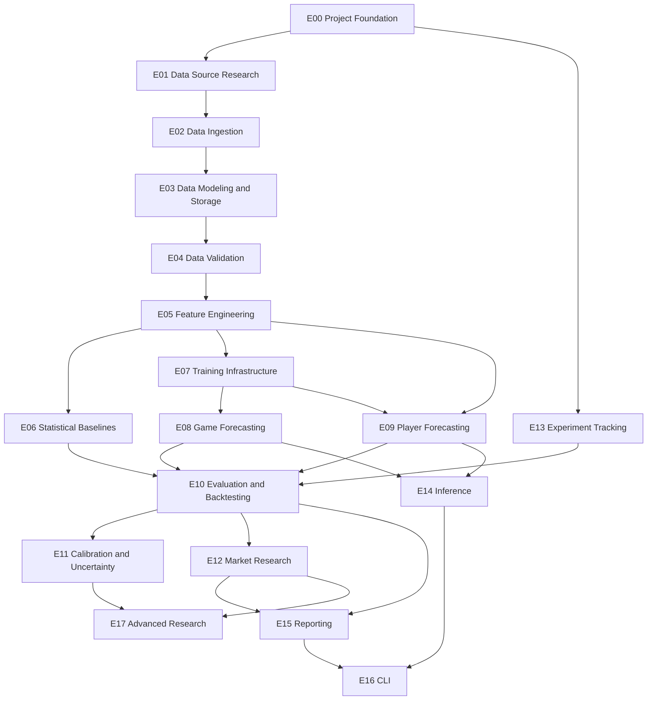

# NBA-DEGENERATE-GAMBLER Feature List

**Version:** 0.1.0  
**Status:** Planned  
**Reference:** `PRD.md`, `ARCHITECTURE.md`

---

## 1. Priority Definitions

| Priority | Meaning |
|---|---|
| P0 | Required for the initial usable release |
| P1 | Required for the complete core platform |
| P2 | Advanced research or optional extension |

### Status Definitions

- `[ ]` Not started.
- `[~]` In progress.
- `[x]` Completed.

Completed tasks should be removed from `TODO.md`, not retained as checked entries.

This document is the feature specification. `TODO.md` is the active implementation board.

---

## 2. Epic Overview

| ID | Epic | Priority | Milestone |
|---|---|---|---|
| E00 | Project Foundation | P0 | M0 |
| E01 | Data Source Research | P0 | M0 |
| E02 | Data Ingestion | P0 | M0 |
| E03 | Data Modeling and Storage | P0 | M0 |
| E04 | Data Validation | P0 | M0 |
| E05 | Feature Engineering | P0/P1 | M1–M3 |
| E06 | Statistical Baselines | P0 | M1 |
| E07 | Training Infrastructure | P0 | M1–M2 |
| E08 | Game Forecasting | P0 | M1–M2 |
| E09 | Player Forecasting | P1 | M3 |
| E10 | Evaluation and Backtesting | P0 | M1–M5 |
| E11 | Calibration and Uncertainty | P1 | M4 |
| E12 | Market Research | P1 | M5 |
| E13 | Experiment Tracking | P0 | M1 |
| E14 | Inference and Prediction History | P1 | M6 |
| E15 | Reporting and Visualization | P0/P1 | M0–M6 |
| E16 | CLI | P0/P1 | M0–M6 |
| E17 | Advanced Research | P2 | Future |

---

# 3. Feature Specifications

## E00: Project Foundation

**Priority:** P0

Establish a reproducible Python development environment and repository structure.

### Features

- [ ] F00-01: Initialize Python package using a `src/` layout.
- [ ] F00-02: Configure Python 3.12+.
- [ ] F00-03: Initialize `uv` project and lockfile.
- [ ] F00-04: Configure Ruff formatting and linting.
- [ ] F00-05: Configure pytest.
- [ ] F00-06: Configure `.gitignore`.
- [ ] F00-07: Configure `.editorconfig`.
- [ ] F00-08: Create Makefile quality gates.
- [ ] F00-09: Establish package and module conventions.
- [ ] F00-10: Establish CI workflow.
- [ ] F00-11: Configure environment and secret handling.
- [ ] F00-12: Establish initial test directory structure.

### Acceptance Criteria

- Project installs and runs in a clean Python environment.
- Package imports work through the intended package layout.
- Ruff checks execute successfully.
- pytest executes successfully.
- Dependency versions are reproducible through `uv.lock`.
- No credentials or local data are committed.
- Quality checks are documented.

---

## E01: Data Source Research

**Priority:** P0

Investigate available NBA data sources before committing to ingestion architecture.

### Features

- [ ] F01-01: Investigate historical game result coverage.
- [ ] F01-02: Investigate historical box score coverage.
- [ ] F01-03: Investigate team statistics coverage.
- [ ] F01-04: Investigate player statistics coverage.
- [ ] F01-05: Investigate play-by-play coverage.
- [ ] F01-06: Investigate historical injury data.
- [ ] F01-07: Investigate historical sportsbook odds.
- [ ] F01-08: Investigate timestamp availability.
- [ ] F01-09: Investigate source licensing and redistribution restrictions.
- [ ] F01-10: Compare source reliability and access limitations.
- [ ] F01-11: Create a dataset coverage matrix.

### Acceptance Criteria

- Every candidate source has documented coverage.
- Retrieval methods are documented.
- Known limitations are recorded.
- Timestamp availability is explicitly investigated.
- Licensing constraints are documented.
- No source is treated as reliable merely because an endpoint responds successfully.

**Deliverable:** `docs/datasets/COVERAGE.md`

---

## E02: Data Ingestion

**Priority:** P0

Build replaceable adapters for external NBA data sources.

### Features

- [ ] F02-01: Define a common source adapter interface.
- [ ] F02-02: Implement initial NBA Stats adapter.
- [ ] F02-03: Implement historical dataset import adapter.
- [ ] F02-04: Implement game result collector.
- [ ] F02-05: Implement box score collector.
- [ ] F02-06: Implement team statistics collector.
- [ ] F02-07: Implement player statistics collector.
- [ ] F02-08: Implement incremental ingestion.
- [ ] F02-09: Implement retries and timeouts.
- [ ] F02-10: Implement rate-limit handling.
- [ ] F02-11: Preserve raw responses.
- [ ] F02-12: Record retrieval metadata.
- [ ] F02-13: Detect incomplete downloads.
- [ ] F02-14: Implement ingestion logging.

### Acceptance Criteria

- Source adapters expose consistent internal interfaces.
- Raw responses can be inspected.
- Retrieval timestamps are recorded.
- Failed requests are reported.
- Retries are bounded and configurable.
- Duplicate downloads do not create duplicate canonical records.
- Ingestion can resume without unnecessarily downloading everything again.

---

## E03: Data Modeling and Storage

**Priority:** P0

Define canonical entities and persistent dataset organization.

### Features

- [ ] F03-01: Define Game schema.
- [ ] F03-02: Define Team schema.
- [ ] F03-03: Define Player schema.
- [ ] F03-04: Define PlayerGame schema.
- [ ] F03-05: Define TeamGame schema.
- [ ] F03-06: Define dataset metadata schema.
- [ ] F03-07: Define temporal metadata conventions.
- [ ] F03-08: Implement Parquet storage.
- [ ] F03-09: Integrate DuckDB.
- [ ] F03-10: Implement dataset version metadata.
- [ ] F03-11: Implement historical team/player identity resolution.
- [ ] F03-12: Define partitioning strategy.

### Acceptance Criteria

- Canonical schemas are documented.
- Historical entities can be joined consistently.
- Dataset writes are deterministic where applicable.
- Dataset metadata identifies source and transformation versions.
- Historical team/player associations are preserved.
- Storage supports bounded-memory analytical workflows.

---

## E04: Data Validation

**Priority:** P0

Prevent malformed or inconsistent data from silently entering research pipelines.

### Features

- [ ] F04-01: Implement schema validation.
- [ ] F04-02: Implement required-field validation.
- [ ] F04-03: Implement duplicate detection.
- [ ] F04-04: Implement referential integrity checks.
- [ ] F04-05: Implement timestamp validation.
- [ ] F04-06: Implement missing-value reports.
- [ ] F04-07: Implement statistical range checks.
- [ ] F04-08: Implement ingestion validation reports.
- [ ] F04-09: Implement dataset quality summaries.
- [ ] F04-10: Implement temporal consistency tests.

### Acceptance Criteria

- Invalid records are identified.
- Validation failures are reported with useful context.
- Missing values are not silently replaced.
- Duplicate and inconsistent entity relationships are detectable.
- Temporal constraints are testable.
- Validation reports are reproducible.

---

## E05: Feature Engineering

**Priority:** P0/P1

Build reusable point-in-time feature pipelines.

### Team Features

- [ ] F05-01: Calculate Offensive Rating.
- [ ] F05-02: Calculate Defensive Rating.
- [ ] F05-03: Calculate Net Rating.
- [ ] F05-04: Calculate Pace.
- [ ] F05-05: Calculate Effective Field Goal Percentage.
- [ ] F05-06: Calculate True Shooting Percentage.
- [ ] F05-07: Calculate Turnover Percentage.
- [ ] F05-08: Calculate Rebounding Percentage.
- [ ] F05-09: Calculate Free Throw Rate.

### Temporal Features

- [ ] F05-10: Implement rolling averages.
- [ ] F05-11: Implement configurable rolling windows.
- [ ] F05-12: Implement exponential moving averages.
- [ ] F05-13: Implement season-to-date statistics.
- [ ] F05-14: Implement recent performance trends.
- [ ] F05-15: Implement historical volatility features.

### Schedule Features

- [ ] F05-16: Implement home/away features.
- [ ] F05-17: Calculate rest days.
- [ ] F05-18: Identify back-to-back games.
- [ ] F05-19: Calculate schedule congestion.
- [ ] F05-20: Implement consecutive road-game features.
- [ ] F05-21: Investigate travel-distance features.

### Matchup Features

- [ ] F05-22: Implement offensive versus defensive comparisons.
- [ ] F05-23: Implement pace matchup features.
- [ ] F05-24: Implement rebounding matchup features.
- [ ] F05-25: Implement historical matchup features.

### Player Features

- [ ] F05-26: Implement player rolling statistics.
- [ ] F05-27: Implement player workload features.
- [ ] F05-28: Implement player usage features.
- [ ] F05-29: Implement historical player role features.
- [ ] F05-30: Implement teammate availability features.

### Point-in-Time Validation

- [ ] F05-31: Implement prediction-time feature filtering.
- [ ] F05-32: Add rolling-window leakage tests.
- [ ] F05-33: Add historical availability tests.
- [ ] F05-34: Validate training/inference feature consistency.

### Acceptance Criteria

- Features are computed only from permitted historical information.
- Rolling calculations exclude the target game.
- Feature definitions are reusable.
- Missing data behavior is explicit.
- Feature datasets are versioned.
- Automated temporal leakage tests pass.

---

## E06: Statistical Baselines

**Priority:** P0

Implement simple forecasting methods before deep learning.

### Features

- [ ] F06-01: Implement historical home-court baseline.
- [ ] F06-02: Implement Elo rating system.
- [ ] F06-03: Implement configurable Elo parameters.
- [ ] F06-04: Implement logistic regression.
- [ ] F06-05: Implement linear regression for score prediction.
- [ ] F06-06: Implement XGBoost baseline.
- [ ] F06-07: Implement LightGBM baseline.
- [ ] F06-08: Persist baseline configurations.
- [ ] F06-09: Generate baseline comparison reports.

### Acceptance Criteria

- Every baseline can be trained and evaluated independently.
- Baselines use the same chronological evaluation framework.
- Results are reproducible.
- Hyperparameters are recorded.
- Metrics are comparable across models.

---

## E07: Training Infrastructure

**Priority:** P0

Establish reusable model training infrastructure.

### Features

- [ ] F07-01: Define training configuration schema.
- [ ] F07-02: Implement dataset loading.
- [ ] F07-03: Implement batch construction.
- [ ] F07-04: Implement configurable optimizers.
- [ ] F07-05: Implement configurable loss functions.
- [ ] F07-06: Implement training loops.
- [ ] F07-07: Implement validation loops.
- [ ] F07-08: Implement checkpoint saving.
- [ ] F07-09: Implement checkpoint recovery.
- [ ] F07-10: Implement early stopping where appropriate.
- [ ] F07-11: Implement training metrics.
- [ ] F07-12: Support CPU execution.
- [ ] F07-13: Support optional CUDA execution.
- [ ] F07-14: Implement resource-aware batch configuration.

### Acceptance Criteria

- Training is configuration-driven.
- CPU execution works.
- CUDA is optional.
- Checkpoints can be restored.
- Training metadata is recorded.
- Training does not require loading the entire dataset into memory.

---

## E08: Game Forecasting

**Priority:** P0

Develop game-level forecasting capabilities.

### Features

- [ ] F08-01: Define game prediction input schema.
- [ ] F08-02: Define game prediction output schema.
- [ ] F08-03: Implement home/away win probability output.
- [ ] F08-04: Implement expected score output.
- [ ] F08-05: Implement point differential prediction.
- [ ] F08-06: Implement total points prediction.
- [ ] F08-07: Implement PyTorch MLP.
- [ ] F08-08: Implement temporal GRU encoder.
- [ ] F08-09: Implement LSTM comparison model.
- [ ] F08-10: Implement multi-task prediction architecture.
- [ ] F08-11: Validate probability constraints.
- [ ] F08-12: Compare neural models against baselines.
- [ ] F08-13: Persist game predictions.

### Acceptance Criteria

- Models generate valid home/away probabilities.
- Probabilities sum to one within numerical tolerance.
- Expected scores and margins are generated.
- Predictions contain timestamps and model identifiers.
- Neural models are evaluated against statistical baselines.
- No model is promoted based only on training performance.

---

## E09: Player Forecasting

**Priority:** P1

Build player-level statistical forecasting.

### Features

- [ ] F09-01: Define player prediction input schema.
- [ ] F09-02: Define player prediction output schema.
- [ ] F09-03: Implement expected minutes prediction.
- [ ] F09-04: Implement points prediction.
- [ ] F09-05: Implement rebounds prediction.
- [ ] F09-06: Implement assists prediction.
- [ ] F09-07: Implement player temporal encoder.
- [ ] F09-08: Implement player context encoder.
- [ ] F09-09: Implement multi-task player prediction heads.
- [ ] F09-10: Incorporate historical team membership.
- [ ] F09-11: Incorporate teammate availability when available.
- [ ] F09-12: Evaluate by playing-time and role segments.

### Acceptance Criteria

- Historical player identity is resolved correctly.
- Expected minutes are modeled explicitly.
- Predictions support all initial target statistics.
- Evaluation is chronological.
- Player-level results are reported separately from game-level results.

---

## E10: Evaluation and Backtesting

**Priority:** P0

Build a common evaluation framework for all forecasting methods.

### Features

- [ ] F10-01: Implement chronological train/validation/test splits.
- [ ] F10-02: Implement expanding-window evaluation.
- [ ] F10-03: Implement rolling-window evaluation.
- [ ] F10-04: Implement walk-forward backtesting.
- [ ] F10-05: Implement prediction persistence.
- [ ] F10-06: Implement classification metrics.
- [ ] F10-07: Implement regression metrics.
- [ ] F10-08: Implement baseline comparison.
- [ ] F10-09: Implement residual analysis.
- [ ] F10-10: Implement evaluation reports.
- [ ] F10-11: Implement final test isolation.
- [ ] F10-12: Implement temporal leakage tests.

### Acceptance Criteria

- Primary evaluation is chronological.
- Final test data does not influence training or calibration.
- Predictions are stored with timestamps.
- Metrics are reproducible.
- Baseline comparisons are available.
- Leakage tests pass.

---

## E11: Calibration and Uncertainty

**Priority:** P1

Improve probability reliability and quantify predictive uncertainty.

### Features

- [ ] F11-01: Implement reliability diagrams.
- [ ] F11-02: Implement Brier Score reporting.
- [ ] F11-03: Implement Log Loss reporting.
- [ ] F11-04: Implement Expected Calibration Error.
- [ ] F11-05: Implement temperature scaling.
- [ ] F11-06: Implement isotonic regression.
- [ ] F11-07: Implement ensemble variance.
- [ ] F11-08: Investigate Monte Carlo dropout.
- [ ] F11-09: Implement prediction intervals.
- [ ] F11-10: Implement calibration reports.

### Acceptance Criteria

- Calibration is fitted on validation data.
- Final test data remains isolated.
- Calibration reports compare pre- and post-calibration behavior.
- Uncertainty estimates are evaluated for coverage and reliability.

---

## E12: Market Research

**Priority:** P1

Investigate differences between model forecasts and sportsbook markets.

### Features

- [ ] F12-01: Define odds snapshot schema.
- [ ] F12-02: Implement sportsbook odds adapter interface.
- [ ] F12-03: Import historical game odds.
- [ ] F12-04: Preserve bookmaker identity.
- [ ] F12-05: Preserve odds timestamps.
- [ ] F12-06: Convert decimal odds into implied probabilities.
- [ ] F12-07: Implement no-vig probability calculation.
- [ ] F12-08: Compare model and market probabilities.
- [ ] F12-09: Implement expected value estimation.
- [ ] F12-10: Implement paper-trading simulation.
- [ ] F12-11: Calculate simulated ROI.
- [ ] F12-12: Calculate maximum drawdown.
- [ ] F12-13: Implement closing-line value analysis.
- [ ] F12-14: Implement market evaluation reports.
- [ ] F12-15: Document sample size and uncertainty.

### Acceptance Criteria

- Odds timestamps are retained.
- Vig is accounted for.
- No-vig calculations are tested.
- Historical simulations use only odds available at the simulated decision time.
- Market evaluation is independent of forecasting evaluation.
- No real-money execution exists.

---

## E13: Experiment Tracking

**Priority:** P0

Make research reproducible and auditable.

### Features

- [ ] F13-01: Integrate MLflow.
- [ ] F13-02: Define experiment metadata schema.
- [ ] F13-03: Record Git commit.
- [ ] F13-04: Record dataset version.
- [ ] F13-05: Record feature configuration.
- [ ] F13-06: Record model configuration.
- [ ] F13-07: Record random seed.
- [ ] F13-08: Record training duration.
- [ ] F13-09: Record evaluation metrics.
- [ ] F13-10: Track checkpoint artifacts.
- [ ] F13-11: Preserve negative experiment results.
- [ ] F13-12: Prevent silent experiment overwrites.

### Acceptance Criteria

- Every meaningful experiment has a unique identifier.
- Experiments can be traced to code and data.
- Configurations can be recovered.
- Results are not silently overwritten.
- Failed experiments remain discoverable.

---

## E14: Inference and Prediction History

**Priority:** P1

Provide a consistent interface for executing trained models.

### Features

- [ ] F14-01: Implement model loading.
- [ ] F14-02: Implement input validation.
- [ ] F14-03: Implement game inference.
- [ ] F14-04: Implement player inference.
- [ ] F14-05: Persist predictions.
- [ ] F14-06: Track prediction timestamps.
- [ ] F14-07: Track model and feature versions.
- [ ] F14-08: Implement historical prediction lookup.

### Acceptance Criteria

- Inference uses validated features.
- Model artifacts can be loaded reproducibly.
- Predictions contain provenance.
- Inference does not modify historical training data.

---

## E15: Reporting and Visualization

**Priority:** P0/P1

Produce interpretable research outputs.

### Features

- [ ] F15-01: Dataset coverage report.
- [ ] F15-02: Dataset quality report.
- [ ] F15-03: Baseline comparison report.
- [ ] F15-04: Game forecasting report.
- [ ] F15-05: Player forecasting report.
- [ ] F15-06: Calibration report.
- [ ] F15-07: Market research report.
- [ ] F15-08: Experiment comparison report.
- [ ] F15-09: Export results to Markdown.
- [ ] F15-10: Export results to CSV.
- [ ] F15-11: Generate Plotly visualizations.

### Acceptance Criteria

- Reports identify the evaluation period.
- Reports identify the model and dataset versions.
- Metrics include relevant context.
- Missing data and limitations are visible.
- Results can be exported without manually editing generated files.

---

## E16: CLI

**Priority:** P0/P1

Provide a unified command-line interface.

### Features

- [ ] F16-01: Initialize Typer application.
- [ ] F16-02: Implement data command group.
- [ ] F16-03: Implement feature command group.
- [ ] F16-04: Implement training command group.
- [ ] F16-05: Implement evaluation command group.
- [ ] F16-06: Implement prediction command group.
- [ ] F16-07: Implement market command group.
- [ ] F16-08: Implement experiment command group.
- [ ] F16-09: Implement reporting command group.
- [ ] F16-10: Add argument validation.
- [ ] F16-11: Add useful help output.
- [ ] F16-12: Implement meaningful exit codes.

### Acceptance Criteria

- Commands are discoverable through help output.
- Invalid arguments produce clear errors.
- Long-running operations provide progress information.
- CLI commands orchestrate modules rather than duplicate their business logic.

---

## E17: Advanced Research

**Priority:** P2

Experimental extensions requiring evidence of value.

### Features

- [ ] F17-01: Investigate Transformer-based temporal encoders.
- [ ] F17-02: Investigate Graph Neural Networks.
- [ ] F17-03: Investigate player interaction graphs.
- [ ] F17-04: Investigate advanced ensemble methods.
- [ ] F17-05: Investigate distributional forecasting.
- [ ] F17-06: Investigate feature attribution methods.
- [ ] F17-07: Investigate model drift detection.
- [ ] F17-08: Investigate prospective performance monitoring.
- [ ] F17-09: Investigate advanced player prop markets.

### Acceptance Criteria

- Each experiment has a documented hypothesis.
- Appropriate baselines are available.
- Evaluation methodology is documented before interpreting results.
- Added complexity demonstrates measurable value.
- Negative findings are retained.

---

# 4. Dependency Map

Dependencies represent logical prerequisites. Some tasks can be developed in parallel after their shared interfaces are established.

---

# 5. Initial Implementation Sequence

The initial sequence should prioritize validated data and statistical benchmarks.

### Phase 0: Bootstrap

- E00 Project Foundation.
- Initial documentation.
- Repository conventions.
- CI and local quality gates.

### Phase 1: Data Foundation

- E01 Data Source Research.
- E02 Data Ingestion.
- E03 Data Modeling and Storage.
- E04 Data Validation.

**Exit condition:** Historical game results and box scores can be ingested, normalized, validated, and reproduced.

### Phase 2: First Forecasting Baselines

- E05 Team and temporal feature engineering.
- E06 Statistical baselines.
- E10 Initial chronological evaluation.
- E13 Experiment tracking.

**Exit condition:** Reproducible Elo, regression, and gradient boosting results exist.

### Phase 3: Initial Deep Learning

- E07 Training infrastructure.
- E08 Game forecasting.
- E10 Deep learning evaluation.

**Exit condition:** MLP and GRU models can be trained and compared against statistical baselines.

### Phase 4: Player Forecasting

- E05 Player feature engineering.
- E09 Player forecasting.
- E10 Player evaluation.

### Phase 5: Advanced Evaluation

- E11 Calibration and uncertainty.
- Additional evaluation and reporting.

### Phase 6: Market Research

- E12 Market research.
- Timestamped odds ingestion.
- Paper-trading evaluation.

### Phase 7: Application Interface

- E14 Inference.
- E15 Reporting.
- E16 CLI completion.

### Phase 8: Experimental Research

- E17 Advanced Research.

---

# 6. Testing Requirements

Every feature must have appropriate tests.

| Test Category | Expected Coverage |
|---|---|
| Unit | Individual functions and calculations |
| Integration | Interactions between modules |
| Data | Schemas, integrity, and validation |
| Temporal | Point-in-time correctness |
| Research | Evaluation and leakage prevention |
| Reproducibility | Repeatable experiment behavior |

A feature is not complete merely because its implementation executes.

### Mandatory Checks for Relevant Features

- Normal inputs.
- Boundary conditions.
- Invalid inputs.
- Missing values.
- Temporal boundaries.
- Reproducibility where applicable.

---

# 7. Global Definition of Done

A feature is complete when:

1. Its implementation matches the documented requirement.
2. Its public interfaces are documented.
3. Relevant tests pass.
4. Data and temporal assumptions are explicit.
5. Errors are handled appropriately.
6. No unrelated functionality is modified.
7. Documentation is updated.
8. The final diff has been reviewed.
9. The relevant quality gates pass.
10. Its results are reproducible where applicable.

---

# 8. Explicit Exclusions

The following are not part of the initial implementation:

- Real-money betting execution.
- Automated sportsbook account interaction.
- Cloud-hosted inference.
- Distributed training.
- Kubernetes.
- Microservices.
- Mandatory PostgreSQL.
- Mandatory Redis.
- Mandatory Kafka.
- Large Transformer models.
- Real-time player tracking infrastructure.

These may be reconsidered through explicit research and architectural decisions.

---

## Final Principle

The project should progress from trustworthy data to defensible baselines, then to increasingly sophisticated models.

A feature is valuable when it improves the reliability or research capability of NBA-DEGENERATE-GAMBLER, not merely because it adds another library or architecture.

**Build the evidence first. Optimize the models second.**
